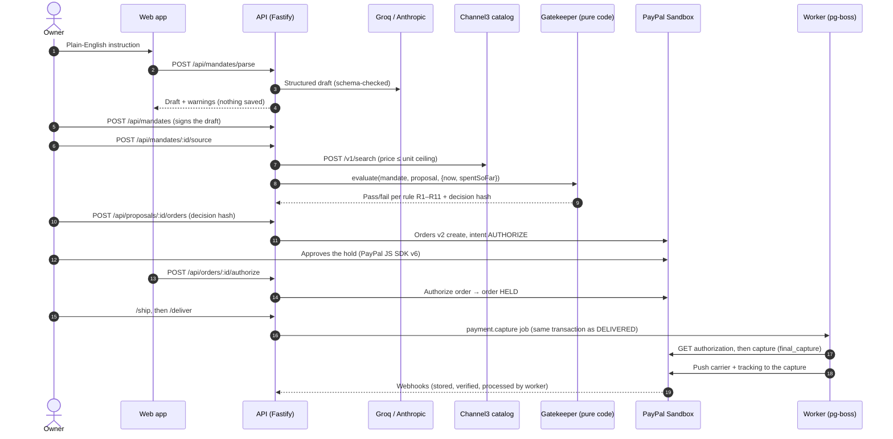
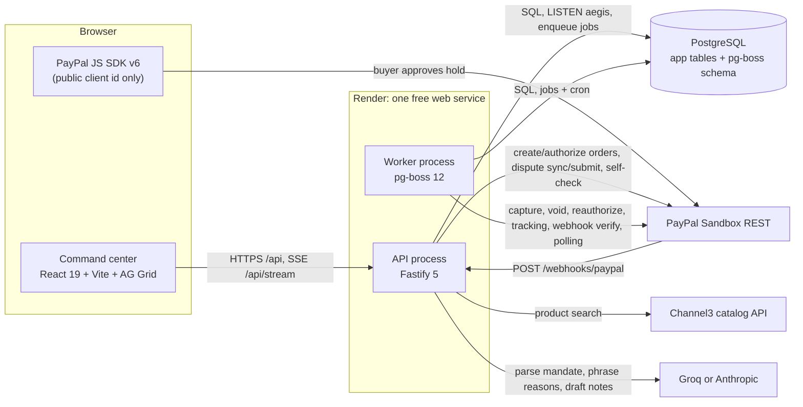
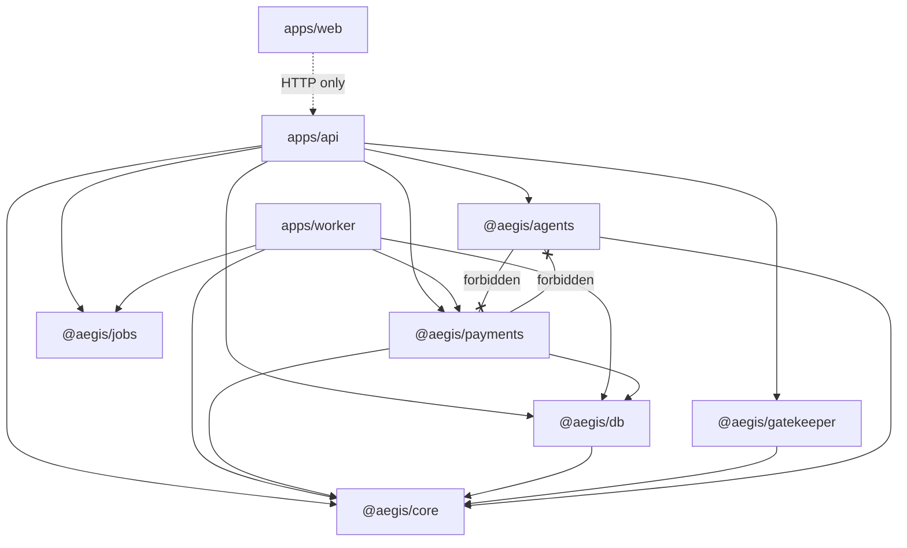
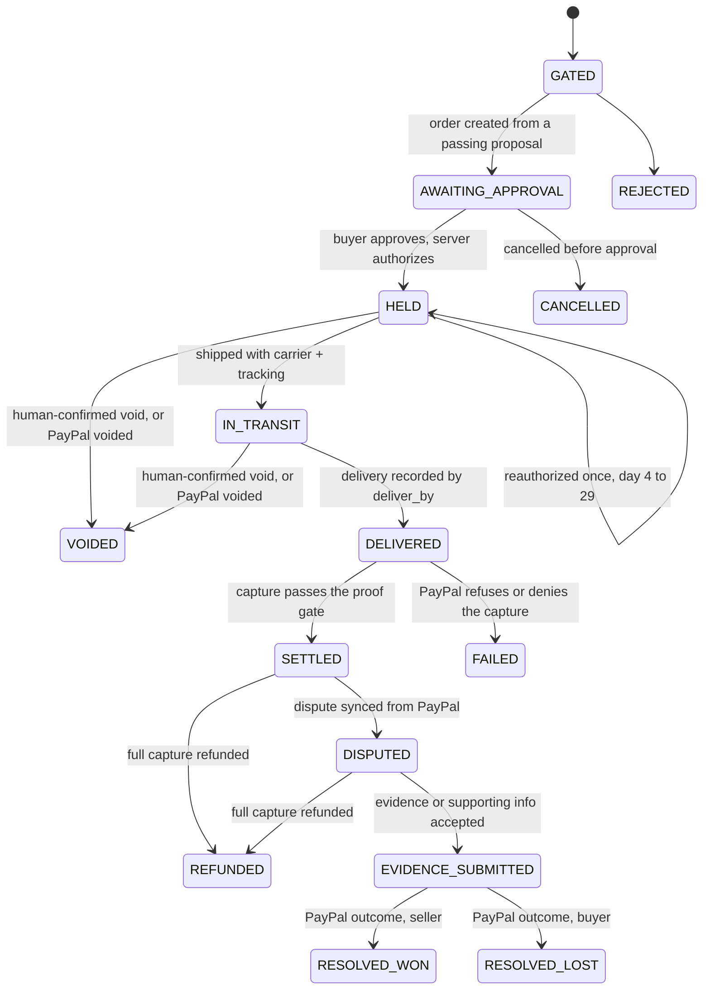

# AegisPay

**Give procurement to AI agents without giving them the wallet.**

AegisPay is a control plane for small businesses that want AI agents to buy for them. An owner signs a **mandate** (what to buy, how many, a unit-price ceiling, a budget, a delivery date). An agent searches a live catalog and proposes offers. A deterministic **gatekeeper** checks each proposal against the mandate, and no language model takes part in that check. Money moves only through a PayPal Orders v2 `intent: AUTHORIZE` **hold** that a person approves. The hold is **captured only after delivery is recorded** and a proof gate passes against PayPal's live authorization. If the buyer disputes, AegisPay builds the evidence from a **hash-chained audit log**, a person attests to it, and AegisPay answers PayPal through whichever channel PayPal currently offers.

- **Sandbox only.** Both processes refuse to start against any PayPal host other than `api-m.sandbox.paypal.com` (loopback is allowed for tests).
- **Live demo:** <https://aegispay-w12c.onrender.com>. It runs on Render's free plan, so the first request after an idle period takes about a minute.
- Built for the PayPal AI Hackathon 2026. Apache-2.0.

---

## Contents

- [How an order moves](#how-an-order-moves)
- [Safety guarantees](#safety-guarantees)
- [The gatekeeper rules](#the-gatekeeper-rules)
- [Architecture](#architecture)
- [Order state machine](#order-state-machine)
- [PayPal integration](#paypal-integration)
- [Webhooks](#webhooks)
- [Dispute defense](#dispute-defense)
- [Worker queues and schedules](#worker-queues-and-schedules)
- [Data model](#data-model)
- [Audit log](#audit-log)
- [AI agents: what the model may and may not do](#ai-agents-what-the-model-may-and-may-not-do)
- [HTTP API](#http-api)
- [Live stream](#live-stream)
- [Web app](#web-app)
- [Getting started](#getting-started)
- [Configuration](#configuration)
- [Testing](#testing)
- [Deployment](#deployment)
- [Security](#security)
- [Known limits](#known-limits)
- [File structure](#file-structure)
- [Further documentation](#further-documentation)

---

## How an order moves



Fulfilment is **simulated**: no real carrier integration exists. Every shipment and delivery row is recorded with `source = 'SIMULATED'`, and the audit log says so.

---

## Safety guarantees

| # | Guarantee | Enforced in |
|---|-----------|-------------|
| 1 | Every proposal is judged by a pure, total, deterministic function: no I/O, no clock, no randomness, no model. All 11 rules always run, so the full checklist is stored. | [`packages/gatekeeper`](packages/gatekeeper). CI enforces 100% line, branch and function coverage. |
| 2 | Agents cannot pay. `packages/agents` imports only `@aegis/core`. Importing `@aegis/payments` or the PayPal server SDK fails `pnpm lint`. | [`eslint.boundaries.config.mjs`](eslint.boundaries.config.mjs), tested by [`test/boundaries.test.ts`](test/boundaries.test.ts) |
| 3 | Money is only held. `createHold` sends amounts read from the gated proposal in the database, never from the request. It refuses if the decision hash, the mandate version or the recomputed total does not match. | [`packages/payments/src/orders.ts`](packages/payments/src/orders.ts) |
| 4 | Capture requires proof. The order must be `DELIVERED`, with a carrier, a tracking number and a delivery date on or before the deadline. The stored amount must equal the recomputed amount. A fresh GET must show PayPal's authorization as `CREATED`/`PENDING`, unexpired and for exactly that amount. A failed check is audited and nothing is sent. | `capture` in [`packages/payments/src/authorizations.ts`](packages/payments/src/authorizations.ts) |
| 5 | An SLA breach only *flags* the hold. A named person confirms the void. | `sla.watch` in [`apps/worker/src/jobs.ts`](apps/worker/src/jobs.ts), `POST /api/orders/:id/void` |
| 6 | Dispute answers are built from stored facts, hashed, and attested by a person. They are sent only after a live GET shows the matching action is open. | [`packages/payments/src/disputes.ts`](packages/payments/src/disputes.ts) |
| 7 | Every state change is written to an append-only, hash-chained audit log in the same transaction as the change. | [`packages/db/src/audit.ts`](packages/db/src/audit.ts), migration `0002` |
| 8 | Two kill switches. PayPal writes are off unless `PAYPAL_WRITES_ENABLED` is exactly `true`, and this is read on every call. Any non-sandbox host or `PAYPAL_ENVIRONMENT` stops the process at startup. | [`packages/payments/src/config.ts`](packages/payments/src/config.ts) |

---

## The gatekeeper rules

The rules are defined in [`packages/gatekeeper/src/rules.ts`](packages/gatekeeper/src/rules.ts). `evaluate()` returns `{ pass, results[], total, decisionSha256 }`. The hash is `sha256(canonicalJson({ mandateSha, proposal, results }))`. It is stored with the proposal and must be presented again to open a hold.

| Rule | Check |
|------|-------|
| R1 | Mandate is `ACTIVE` and `now ≤ expiresAt` (both instants must carry a time zone) |
| R2 | Proposal targets the mandate's current id **and** version |
| R3 | `0 ≤ unitPrice ≤ unitCeiling` |
| R4 | Currency matches (USD only) |
| R5 | Quantity equals the mandate quantity |
| R6 | `unitPrice × qty + shipping + tax ≤ budget − spentSoFar` |
| R7 | Supplier ETA is on or before `deliverBy` |
| R8 | `deliverBy` is within 29 days of today: PayPal's authorization validity window |
| R9 | Supplier domain is on the allow-list (if one is set) and rating ≥ `minRating` (if set) |
| R10 | In stock |
| R11 | Title contains every `mustInclude` term and no `mustExclude` term (case-insensitive whole-word match) |

`spentSoFar` counts every order under the mandate in `AWAITING_APPROVAL`, `HELD`, `IN_TRANSIT`, `DELIVERED`, `SETTLED`, `DISPUTED`, `EVIDENCE_SUBMITTED` or `RESOLVED_WON`. Counting `AWAITING_APPROVAL` stops two proposals from spending the same budget. When a proposal becomes an order, R2 and R6 are checked again under a per-mandate advisory lock ([`packages/db/src/order-flow.ts`](packages/db/src/order-flow.ts)).

---

## Architecture

### Runtime



- **The API** serves the built web app as same-origin static files, the JSON API, the SSE stream and the webhook listener. It only *enqueues* jobs: its pg-boss instance runs with `schedule: false, supervise: false`.
- **The worker** serves no HTTP. It owns queue maintenance, the cron schedules, webhook verification and processing, capture, void, reauthorization, tracking push and refund reconciliation.
- **Both processes** run migrations at startup. A session advisory lock stops two migrations from running at once. Both also keep a Judge Mode `OffsetClock` in sync through the `demo_setting` table, polled every 2 s.
- **On Render** both processes run in one free web service: `pnpm --filter @aegis/worker start & pnpm --filter @aegis/api start & wait -n`. If either process exits, the service restarts.
- **No build step on the server.** TypeScript runs directly through `tsx`, and workspace packages export their `src/index.ts`.

### Package dependencies

This graph is drawn from the actual `import` statements. `pnpm lint` enforces the forbidden edges.



| Package | Responsibility |
|---------|----------------|
| `@aegis/core` | Money as `bigint` minor units (`usd.parse`, `usd.toPayPal`), canonical JSON, SHA-256, the order state machine, `DomainError` and its HTTP status map, injectable clocks (`systemClock`, `FixedClock`, `OffsetClock`), and zod schemas shared by the API and the web app. Imports no other `@aegis` package. |
| `@aegis/gatekeeper` | The pure validator described above. Imports only core. Lint bans `Date.now()`, `new Date()`, `Math.random`, `fetch`, `process` and timers. |
| `@aegis/db` | `pg` pool with `int8 → bigint` and `date → 'YYYY-MM-DD'` parsers, a plain-SQL migrator, the guarded `transition()`, the audit chain, and repositories for mandates, proposals, orders, fulfilment, refunds, disputes and webhook events. UUIDv7 ids. |
| `@aegis/payments` | The only code that calls PayPal. Includes `paypalCall` (kill switch, deterministic request id, retries, an audit row per attempt), a token vault, Orders and Payments through `@paypal/paypal-server-sdk`, a narrow REST client for disputes and webhooks, the evidence planner, a PDF renderer (`pdf-lib`) and the webhook pipeline. |
| `@aegis/agents` | Mandate parser, Channel3 search and shortlist, dispute-notes drafter, and the grounding checks. Uses the Vercel AI SDK. Has no database access and no PayPal access. |
| `@aegis/jobs` | Queue names, retry policies, cron schedules, zod payload schemas, and the `JobSender` the API uses to enqueue. This lets the apps share queues without importing each other. |

---

## Order state machine

Defined once in [`packages/core/src/order-state.ts`](packages/core/src/order-state.ts) (`ALLOWED_TRANSITIONS`). A unit test asserts that it matches the diagram in the Technical Documentation.



- **`transition()` is the only way state changes** ([`packages/db/src/orders.ts`](packages/db/src/orders.ts)). It runs one guarded `UPDATE … WHERE id = $1 AND state = ANY($from)` and returns `APPLIED`, `ALREADY_THERE` or `CONFLICT`. A webhook and a click racing on the same order can never both apply. A `from → to` pair that is not in the map throws.
- **Failing proposals never become orders.** They are kept as `proposal` rows with `gate_pass = false` and the rules they failed. The `GATED → REJECTED` edge exists in the map but the app never takes it.
- **A dispute PayPal resolves before AegisPay answers** leaves the order in `DISPUTED`. Moving it to `RESOLVED_*` would claim evidence that was never sent. PayPal's outcome is stored and audited as `DISPUTE_RESOLVED_WITHOUT_EVIDENCE`.

---

## PayPal integration

Orders, authorizations, captures and refunds go through `@paypal/paypal-server-sdk` 2.5. Disputes, webhook verification and the event simulator go through one narrow REST client ([`packages/payments/src/rest.ts`](packages/payments/src/rest.ts)). Both paths share the token vault and the `paypalCall` wrapper.

| PayPal API | Used for | Code |
|------------|----------|------|
| Orders v2: create order (`intent: AUTHORIZE`) | Open the hold. `brand_name: AegisPay`, `shipping_preference: GET_FROM_FILE`, invoice id `AEG-<last 12 hex of order id>` | `createHold` in `orders.ts` |
| Orders v2: show order | Read buyer approval (poller, recovery) | `getPayPalOrder` |
| Orders v2: authorize | Turn the approved order into an authorization | `authorizeHold` |
| Orders v2: add tracking | Push carrier + tracking after capture | `pushTracking` |
| Payments v2: show / capture / void / reauthorize authorization | Proof-gated capture, released holds, extending a hold | `authorizations.ts` |
| Payments v2: refund capture, show refund | Partial and full refunds (a library function that no API route calls), and reconciling `PENDING` refunds | `refunds.ts` |
| Payments v2: show capture | Reconcile on webhook | `webhooks/process.ts` |
| Webhooks: verify-webhook-signature, certificate download | Online postback check, plus an offline RSA-SHA256 check for simulator events | `webhooks/verify*.ts` |
| Webhooks: simulate-event | Prove the webhook path against the live sandbox | `webhooks/simulate.ts` |
| Customer Disputes v1: show, provide-evidence, provide-supporting-info | Dispute defense | `disputes.ts` |
| JS SDK v6 (browser) | Buyer approval. `findEligibleMethods()` runs before the button is enabled. `start()` receives a promise of `{ orderId }` | [`apps/web/src/components/PayPalApprove.tsx`](apps/web/src/components/PayPalApprove.tsx) |

### Idempotency, retries, audit

[`packages/payments/src/call.ts`](packages/payments/src/call.ts) and [`request-id.ts`](packages/payments/src/request-id.ts):

- **`PayPal-Request-Id = sha256(orderRowId:action:attempt)`.** Every retry of one logical operation sends the same id, so PayPal replays the original result. A deliberately new attempt, such as a reauthorization or an authorize after `INSTRUMENT_DECLINED`, increments `attempt`.
- **Retry policy:**
  - 5xx or network error: retried at 1 s, 4 s and 10 s.
  - 429: retried at 10 s and 30 s.
  - 401: one token refresh, then one retry.
  - Each delay gets ±20% jitter. Any other 4xx is final.
- **Dispute POSTs are not retried after a 5xx or network error.** PayPal documents no idempotency key for them, so a failed submit is shown to a person instead of being sent twice.
- **Every attempt appends a `PAYPAL_CALL` audit row** with PayPal's `debug_id`, in its own transaction after the network call. No database transaction is held open across a network call.
- **Concurrency guards:**
  - Captures and refunds of one order are serialized by a session advisory lock (`capture:<id>`, `refund:<id>`). The lock is polled with `pg_try_advisory_lock`, so waiting callers do not exhaust the connection pool.
  - The worker's payment queues use pg-boss `stately` policy: per order, at most one job queued and one active.
- **Reauthorization** happens only after the 3-day honor period ends: `now ≥ honor_ends_at + 10 min` and before `auth_expires_at`. It happens at most once, uses PayPal's real clock (never the demo clock), and is skipped for holds that are past their SLA.
- **`INSTRUMENT_DECLINED`** (422) is a typed error. It is never retried, and it is audited as `HOLD_INSTRUMENT_DECLINED`. The buyer is sent back to PayPal to choose another funding source.

---

## Webhooks

`POST /webhooks/paypal` ([`apps/api/src/routes/webhooks.ts`](apps/api/src/routes/webhooks.ts)):

1. **Store.** The exact raw bytes (1 MB limit, own content-type parser) and headers are stored under PayPal's event id. A redelivery is a no-op.
2. **Nudge.** A `webhook.process` job is enqueued, a singleton per event id. If enqueueing fails, a per-minute cron sweep picks the event up anyway.
3. **Answer.** The listener returns `200` for anything PayPal could send. It returns `500` only when the event could not be **stored**, so that PayPal redelivers it.

The worker ([`packages/payments/src/webhooks/pipeline.ts`](packages/payments/src/webhooks/pipeline.ts)) then:

- **Verifies** each stored event with PayPal's `verify-webhook-signature`, splicing in the raw body verbatim. Events whose id came back from AegisPay's own `simulate-event` call are verified offline instead: CRC32 of the raw body, an RSA-SHA256 certificate check, and certificate hosts on an allow-list. Verification **fails closed** when `PAYPAL_WEBHOOK_ID` is unset. A transient failure retries up to 3 times, then the event is closed with a `WEBHOOK_GAVE_UP` audit row.
- **Processes** verified events oldest first, claiming them with `FOR UPDATE SKIP LOCKED`. Every handler **re-fetches the resource from PayPal** and moves the order only along an allowed edge. An event for an unknown order is recorded as `WEBHOOK_UNLINKED`. A conflict with local state is recorded as `WEBHOOK_STATE_MISMATCH`. Neither moves anything.

**Handled event types:**

- `CHECKOUT.ORDER.APPROVED`
- `PAYMENT.AUTHORIZATION.CREATED`
- `PAYMENT.AUTHORIZATION.VOIDED`
- `PAYMENT.CAPTURE.COMPLETED`
- `PAYMENT.CAPTURE.DENIED`
- `PAYMENT.CAPTURE.REFUNDED`
- `CUSTOMER.DISPUTE.CREATED`
- `CUSTOMER.DISPUTE.UPDATED`
- `CUSTOMER.DISPUTE.RESOLVED`

The first two are a backstop for a browser `onApprove` that never reached the API.

---

## Dispute defense

[`packages/payments/src/disputes.ts`](packages/payments/src/disputes.ts), [`evidence/plan.ts`](packages/payments/src/evidence/plan.ts), [`evidence/pdf.ts`](packages/payments/src/evidence/pdf.ts):

1. **Sync.** The dispute is matched to an order through `disputed_transactions[].seller_transaction_id` = capture id. The match moves the order `SETTLED → DISPUTED`.
2. **Plan.** A pure function maps the dispute reason to the evidence PayPal expects. If a required fact is missing, the result is `BLOCKED` and names the fact. A weaker case is never sent in its place.

   | Reason | Evidence | Documents |
   |--------|----------|-----------|
   | `MERCHANDISE_OR_SERVICE_NOT_RECEIVED` | `PROOF_OF_FULFILLMENT` (tracking) | Fulfilment record |
   | `UNAUTHORISED` | Fulfilment + `OTHER` | Fulfilment record, mandate approval |
   | `MERCHANDISE_OR_SERVICE_NOT_AS_DESCRIBED` | `OTHER` | Product snapshot, mandate approval |
   | `INCORRECT_AMOUNT`, `DUPLICATE_TRANSACTION` | `PROOF_OF_REFUND` if refunds exist, otherwise `OTHER` | Ledger extract |
   | `CREDIT_NOT_PROCESSED` | `PROOF_OF_REFUND` | None |
   | Any other reason | `OTHER`, flagged for manual review | Ledger, mandate, and fulfilment if available |

3. **Draft.** `draftEvidenceNotes` builds a numbered fact list from stored records. If a model is configured, it phrases the facts. The result is kept only if every figure in it appears in the facts and every `[Fn]` citation names a real fact. Otherwise a template written from the facts is used, with author `system:evidence-template`. Notes must be ≤ 2,000 characters.
4. **Store.** Up to 3 text-only PDFs (≤ 10 MB each) are rendered and stored with the `input` JSON. The bundle hash covers the input and each file's name and SHA-256. What a person reviews is byte-for-byte what is sent.
5. **Attest and submit.** A named person attests to the bundle hash (`EVIDENCE_REVIEWED`). Immediately before the POST, a fresh GET must offer the action the bundle was built for:
   - `provide-evidence` requires status `WAITING_FOR_SELLER_RESPONSE` and an open response window.
   - `provide-supporting-info` requires stage `CHARGEBACK`, `PRE_ARBITRATION` or `ARBITRATION`.

   A bundle built for one action is refused if PayPal now offers the other. The person must draft again, so a fresh review always covers what is sent. `accept_claim` is never called, because it refunds the buyer.
6. **Read back.** After commit, the dispute is fetched again and the counts of what PayPal lists are audited as `EVIDENCE_READBACK`. The order moves `DISPUTED → EVIDENCE_SUBMITTED`.
7. **Crash recovery.** PayPal may accept the POST and the local commit may then fail. In that case the next attempt finds the `ok: true` audit row, finishes locally and sends nothing (`EVIDENCE_SUBMIT_RECOVERED`).

Status against the real sandbox: the `provide-supporting-info` path was answered live on 2026-11-09. `provide-evidence` is covered only by the local PayPal double. Details are in [`docs/SANDBOX_VERIFICATION.md`](docs/SANDBOX_VERIFICATION.md).

---

## Worker queues and schedules

Defined in [`packages/jobs/src/queues.ts`](packages/jobs/src/queues.ts). Handlers are in [`apps/worker/src/jobs.ts`](apps/worker/src/jobs.ts).

| Queue | Policy | Retries | Trigger | Does |
|-------|--------|---------|---------|------|
| `webhook.process` | `short` | 3 | Listener (per event) + cron every minute | Verify, then process stored events |
| `payment.capture` | `stately` | 3 | `/deliver`, in the same transaction (outbox) | Proof-gated capture, then queues tracking |
| `payment.void` | `stately` | 3 | `/void` (human-confirmed), in the same transaction | Void the authorization |
| `tracking.push` | `stately` | 3 | After capture; webhook processor | Push tracking to PayPal once (`pushed_to_paypal_at`) |
| `sla.watch` | `exclusive` | 0 | Cron `* * * * *` | Flag `HELD`/`IN_TRANSIT` orders past `deliver_by` (`SLA_BREACH_FLAGGED`), once per order |
| `poll.open` | `exclusive` | 0 | Cron `*/2 * * * *` | Cover webhook gaps: approved but unauthorized orders, holds PayPal voided or expired, open disputes |
| `payment.reauth` | `exclusive` | 0 | Cron `*/15 * * * *` | Reauthorize holds that are due |
| `refund.reconcile` | `exclusive` | 0 | Cron `*/5 * * * *` | Settle `PENDING` refunds to their PayPal status |

Each job failure falls into one of three classes:

- **Deferred:** the kill switch is off. The job re-queues itself and burns no retry.
- **Permanent:** wrong state, failed proof gate or malformed payload. The job completes and the audit log holds the reason.
- **Retry:** pg-boss retries with backoff.

---

## Data model

Plain SQL migrations live in [`packages/db/migrations`](packages/db/migrations). Each file runs once in its own transaction and is recorded in `schema_migration` with a checksum. Editing an applied file is an error. Money is `bigint` minor units with a `char(3)` currency (USD only).

| Table | Holds |
|-------|-------|
| `mandate` | Versioned terms, primary key `(id, version)`. Amending inserts `version + 1`, never edits. `sha256` fingerprints the terms. Status is `ACTIVE`, `PAUSED` or `CLOSED`. |
| `catalog_snapshot` | The exact Channel3 response a proposal was built from, with its SHA-256 |
| `proposal` | One gated offer: prices, ETA, rating, stock, `gate_pass`, `gate_results`, `decision_sha256` |
| `purchase_order` | State, amount, PayPal order / authorization / capture ids, `authorization_history`, honor and expiry times, approver, `row_version` |
| `fulfillment` | Carrier, tracking, shipped and delivered times, `source` (`SIMULATED`), `pushed_to_paypal_at` |
| `refund` | One row per PayPal refund (supports partial refunds). Status, reason, `confirmed_by` |
| `dispute` | PayPal dispute id, reason, status, stage, seller response due date, live `links`, outcome |
| `evidence_bundle` | Plan, `input_json`, PDFs (base64 + SHA-256), bundle hash, `reviewed_by`, `submitted_at`, PayPal response |
| `webhook_event` | Event id (idempotency key), raw body `bytea`, headers, verification method, attempts, processed time, error |
| `audit_event` | The hash chain (see below) |
| `supplier_profile` | Lead time by domain, which drives the simulated ETA. A `*` row defaults to 3–7 days. |
| `demo_setting` | Judge Mode clock offset, shared by the API and the worker |

`webhook_event` and `audit_event` have no foreign keys, so a demo reset can delete demo rows without touching history.

---

## Audit log

[`packages/db/src/audit.ts`](packages/db/src/audit.ts):

```
hash = sha256( prev_hash ␟ seq ␟ ts ␟ actor ␟ type ␟ entity ␟ entity_id ␟ paypal_request_id ␟ paypal_debug_id ␟ canonical_json(payload) )
```

- **Fields are joined with the ASCII unit separator** (`␟`, `\u001f`), so a value cannot shift between fields undetected. `ts` is microsecond UTC text.
- **Appends are serialized** by a transaction-scoped advisory lock. This keeps `seq` gap-free and stops the chain from forking. Each append runs in the **same transaction** as the change it records, and emits `pg_notify('aegis', seq)` in that transaction.
- **Updates, deletes and truncates are blocked** by database triggers (migration `0002`). This makes the log tamper-*evident*, not tamper-proof: a superuser can still drop the trigger.
- **`verifyChain()`** recomputes every row with a keyset-paged scan and reports the first bad `seq`. The reasons are `SEQ_GAP`, `PREV_HASH_MISMATCH` and `HASH_MISMATCH`. It is exposed as `GET /api/audit/verify`, shown as a badge in the order detail grid, and re-run by the nightly job.
- **Actor prefixes:**
  - `user:<session>`: a person, through the anonymous session
  - `agent:parser`, `agent:sourcing`: the agents
  - `system:payments`, `system:webhooks`: the payments code and the webhook pipeline
  - `system:evidence-template`: dispute notes written from the template

---

## AI agents: what the model may and may not do

The model is selected in [`packages/agents/src/llm.ts`](packages/agents/src/llm.ts). If `ANTHROPIC_API_KEY` is set, it is Anthropic (`claude-sonnet-5-5`). Otherwise, if `GROQ_API_KEY` is set, it is Groq (`openai/gpt-oss-120b`). `AEGIS_LLM_MODEL` overrides either default. The hosted demo uses Groq. Every call uses strict structured output at `temperature: 0`, with at most two attempts: a rejected answer is fed back once.

| Task | Model's job | Without a model |
|------|-------------|-----------------|
| Mandate parser | Turn free text into a draft. Money is text in dollars, converted to minor units by code. Figures the owner never wrote raise warnings. | `POST /api/mandates/parse` answers `503 AGENT_UNAVAILABLE`. The form still works. |
| Sourcing | Write a one-line reason per offer. Ranking is code: in stock, then price, then rating, then id. A reason that states a figure not in the facts is replaced by a template. | Template reasons. Sourcing needs only `CHANNEL3_API_KEY`. |
| Dispute notes | Phrase the numbered facts, with citations | Template notes built from the facts |

The model never decides whether money moves, never sees the database, and has no tools. Agent runs are audited as `AGENT_STEP` and `MANDATE_DRAFTED` rows. Those rows store the structured output and a prompt hash, never the owner's raw text.

---

## HTTP API

Routes are registered in [`apps/api/src/app.ts`](apps/api/src/app.ts) and [`apps/api/src/routes`](apps/api/src/routes). Errors share one shape: `{ error: { code, message, details?, paypalDebugId?, requestId } }`. HTTP statuses come from `HTTP_STATUS` in [`packages/core/src/errors.ts`](packages/core/src/errors.ts). Money is sent as minor-unit decimal strings.

**Open routes (no session):**

| Method | Path | Purpose |
|--------|------|---------|
| GET | `/healthz` | Database ping |
| GET | `/selfcheck`, `/api/selfcheck` | Live probes, rate-limited to 6/min (see below) |
| GET | `/api/session` | Issues the anonymous `aegis_sid` cookie and a CSRF token |
| GET | `/approved`, `/cancelled` | PayPal redirect targets. They redirect back to `/` |
| POST | `/webhooks/paypal` | PayPal webhook listener |

The self-check probes: database `select 1`, PayPal token, the registered webhook, an Orders v2 `AUTHORIZE` create for 1.00 USD that is never approved, and one Channel3 search. Fast probes are cached for 60 s. Probes that create something at PayPal or spend catalog credits are cached for 10 min.

**Session routes:** these need the signed cookie. Every non-GET also needs the `x-csrf-token` header. All except `/api/stream` are rate-limited to 60/min per client.

| Method | Path | Purpose |
|--------|------|---------|
| POST | `/api/mandates/parse` | Free text → draft. Nothing is saved. |
| POST | `/api/mandates` | Sign and store a mandate |
| GET | `/api/mandates`, `/api/mandates/:id` | List / read |
| POST | `/api/mandates/:id/amend` | Insert `version + 1`, keeping the current status. A `CLOSED` mandate cannot be amended. |
| POST | `/api/mandates/:id/status` | `ACTIVE` / `PAUSED` / `CLOSED` |
| POST | `/api/mandates/:id/source` | Catalog search → shortlist → gate → store proposals |
| POST | `/api/proposals/:id/orders` | Create the order and open the PayPal hold. Requires `decisionSha256`. |
| GET | `/api/orders`, `/api/orders/:id/audit` | Grid rows / per-order audit trail |
| POST | `/api/orders/:id/authorize` | After buyer approval. The PayPal order id is read from the database, not the client. |
| POST | `/api/orders/:id/cancel` | `AWAITING_APPROVAL → CANCELLED` |
| POST | `/api/orders/:id/ship` | `HELD → IN_TRANSIT`. Carrier is one of `FEDEX`, `UPS`, `USPS`, `DHL`, `DHL_API`, `OTHER`. |
| POST | `/api/orders/:id/deliver` | `IN_TRANSIT → DELIVERED`, and queues capture in the same transaction |
| POST | `/api/orders/:id/void` | Human-confirmed void, queued in the same transaction |
| GET | `/api/disputes`, `/api/disputes/:id` | List / read |
| POST | `/api/disputes/:id/sync` | Pull from PayPal |
| POST | `/api/disputes/:id/plan` | Draft notes, render PDFs, store the bundle. Nothing is sent. |
| GET | `/api/evidence/:bundleId/files/:name` | Serve a stored PDF, with an `x-content-sha256` header |
| POST | `/api/disputes/:id/submit` | `{ bundleId, attested: true }` → attest and send |
| GET | `/api/audit/verify` | Recompute the hash chain |
| GET | `/api/stream` | SSE stream |
| GET, POST | `/api/demo/clock` | Judge Mode clock offset (0–60 days). Moves only AegisPay's timers, never PayPal's. |
| POST | `/api/demo/reset` | Judge Mode: clear the demo tables. The audit chain, webhook events and supplier profiles are kept. |

The demo routes answer `403` when `JUDGE_MODE=false`.

---

## Live stream

`GET /api/stream` ([`apps/api/src/stream.ts`](apps/api/src/stream.ts)) sends Server-Sent Events. It carries seven event types:

- `order.upsert`
- `dispute.upsert`
- `gate.decision`
- `webhook.verified`
- `agent.step`
- `mandate.draft`
- `selfcheck.result`

Each process holds one `LISTEN aegis` connection and fans it out to every open tab. Events backed by an audit row carry `id = seq`, so a reconnecting client resumes from `Last-Event-ID`. A client too far behind receives `resync` and reloads the grid. `selfcheck.result` is ephemeral and is never replayed. A heartbeat comment is sent every 15 s.

---

## Web app

[`apps/web`](apps/web) is one page with no client-side routes. `vite build` writes it into `apps/api/public`, and the API serves it from the same origin, so the session cookie and CSRF need no CORS.

- **Stack:** React 19, Vite 8, TanStack Query, Zustand, `@paypal/paypal-js` (SDK v6) and Phosphor icons. Fonts are self-hosted through Fontsource (Bodoni Moda, Schibsted Grotesk, Geist Mono).
- **[`CommandGrid.tsx`](apps/web/src/components/CommandGrid.tsx)** uses AG Grid 36 Enterprise and loads lazily in its own chunk. It is a master/detail grid with a per-order audit trail, a live chain-verification badge, a pinned foot row (money held + captured) and CSV export including the PayPal ids and decision hash. Without `VITE_AG_GRID_LICENSE_KEY` the grid shows AG Grid's watermark.
- **Hero:** a three.js scene of the money lanes, driven by live order state and loaded on demand ([`src/scene`](apps/web/src/scene)). It has a GSAP ScrollTrigger lifecycle section and an ambient background that moves only with scroll and pointer. A pause control and a reduced-motion still version are provided.
- **Dialogs:** PayPal approval, ship, void, cancel, an evidence modal (read the PDFs, attest, submit), an agent drawer (parse, source, gate verdicts), and a self-check panel.

---

## Getting started

**Prerequisites:**

- Node ≥ 22. `.nvmrc` pins 22; CI and Render use 24.
- pnpm 11 (`corepack enable`).
- Docker, for Postgres.
- A PayPal **sandbox** REST app (client id + secret).

**Setup:**

```bash
git clone https://github.com/BugHunterX2101/AegisPay && cd AegisPay
pnpm install

docker run -d --name aegispay-pg -p 54329:5432 \
  -e POSTGRES_USER=aegis -e POSTGRES_PASSWORD=aegis -e POSTGRES_DB=aegis_test postgres:16

cp .env.example .env       # fill in PAYPAL_CLIENT_ID / PAYPAL_CLIENT_SECRET and a 32+ char SESSION_SECRET
```

**Run** (migrations apply automatically when either process starts):

```bash
# Option A: development, hot reload. API :3000, worker, Vite :5173 (proxies /api to :3000)
pnpm dev

# Option B: production-like. The API serves the built app on :3000
pnpm build
pnpm start:api
pnpm start:worker          # second terminal
```

Without `pnpm build`, the API serves JSON only. PayPal writes stay off until `PAYPAL_WRITES_ENABLED=true`. Agent routes answer `503 AGENT_UNAVAILABLE` until a model key and `CHANNEL3_API_KEY` are set. Webhooks stay unverified until the API has a public HTTPS URL and you run `pnpm register-webhook <url>`.

### Commands

| Command | What it does |
|---------|--------------|
| `pnpm dev` | API, worker and Vite together (`concurrently`) |
| `pnpm build` | Build the web app into `apps/api/public` |
| `pnpm start:api` / `pnpm start:worker` | Run one process |
| `pnpm migrate` | Apply migrations without starting a process |
| `pnpm typecheck` | `tsc --noEmit` for the workspace and the web app |
| `pnpm lint` | Architecture boundary rules only (not a style linter) |
| `pnpm test` / `pnpm test:coverage` | Unit and integration suite (needs local Postgres) |
| `pnpm test:sandbox` | Live contract tests against the real PayPal sandbox, Channel3 and the model |
| `pnpm e2e` | Playwright against a running instance (`E2E_BASE_URL`, default `http://localhost:3000`) |
| `pnpm seed [--reset] [--count N]` | Real mandates, live catalog and sandbox holds, created through the public API (1–10 orders). Targets `APP_URL`, default `http://localhost:3000`. |
| `pnpm selfcheck` | Run the live self-check against `APP_URL`, default `http://localhost:3000` |
| `pnpm nightly` | Self-check, audit-chain verification, sync of open disputes |
| `pnpm register-webhook <https-url>` | Register `<url>/webhooks/paypal` with PayPal (idempotent) and write `PAYPAL_WEBHOOK_ID` to `.env` |
| `node scripts/demo-order.mjs start\|finish\|status` | Drive one real sandbox order end to end. Targets `APP_URL`; **if unset, it targets the hosted demo**, not localhost. |
| `node scripts/render-deploy.mjs` | Create or update the Render service and database through the Render API (idempotent) |

---

## Configuration

Variables are read from the environment. The apps load the root `.env` through `tsx --env-file-if-exists`. [`.env.example`](.env.example) documents each one.

| Variable | Required | Notes |
|----------|----------|-------|
| `DATABASE_URL` | yes | Shared by the API, the worker and pg-boss |
| `TEST_DATABASE_URL` | tests | Each test file gets its own schema in this database |
| `SESSION_SECRET` | yes (API) | ≥ 32 characters. Signs the session cookie and the CSRF secret. |
| `PORT`, `APP_URL` | no | Default `3000` and `http://localhost:<port>`. `APP_URL` builds PayPal's return URLs, and `https://` turns on `Secure` cookies. |
| `JUDGE_MODE` | no | On unless set to `false` |
| `PAYPAL_CLIENT_ID`, `PAYPAL_CLIENT_SECRET` | yes | Sandbox app. Both processes refuse to start without them. |
| `PAYPAL_ENVIRONMENT` | no | Only `sandbox` (or unset). Anything else stops the process. |
| `PAYPAL_BASE_URL` | no | Only `https://api-m.sandbox.paypal.com` or a loopback host |
| `PAYPAL_WRITES_ENABLED` | no | Only the exact string `true` enables PayPal writes. Read on every call. |
| `PAYPAL_WEBHOOK_ID` | for webhooks | Without it, stored events are never verified or acted on |
| `ANTHROPIC_API_KEY` / `GROQ_API_KEY` | for agents | Anthropic wins if both are set |
| `AEGIS_LLM_MODEL` | no | Model id override |
| `CHANNEL3_API_KEY`, `CHANNEL3_BASE_URL` | for sourcing | The base URL may only be Channel3's host or loopback |
| `VITE_AG_GRID_LICENSE_KEY` | no | Baked into the bundle at build time |
| `RENDER_API_KEY` | deploy script | Used only by `scripts/render-deploy.mjs` |

---

## Testing

| Suite | Runs against | Notes |
|-------|--------------|-------|
| `pnpm test` ([`vitest.config.ts`](vitest.config.ts)) | Real Postgres. PayPal and Channel3 calls go to local contract servers ([`packages/payments/test/paypal-server.ts`](packages/payments/test/paypal-server.ts), `oauth-server.ts`). | Files run one at a time, because `LISTEN/NOTIFY` is per database and not per schema. Agent tests use the hosted model when a key is in `.env`, and the AI SDK's scripted model otherwise. |
| Gatekeeper | (part of `pnpm test`) | Rule tests plus `fast-check` property tests. Coverage is held at 100% by a `vitest` threshold. |
| [`test/boundaries.test.ts`](test/boundaries.test.ts) | The real lint config | Lints violating and allowed snippets, so a rule that silently stops matching fails the suite |
| `pnpm test:sandbox` ([`vitest.sandbox.config.ts`](vitest.sandbox.config.ts)) | Live PayPal sandbox, Channel3, the hosted model | Read-only by default. Files that write skip unless their flag is set: `PAYPAL_WRITES_ENABLED=true`, `SANDBOX_WRITES=1`, `SANDBOX_DISPUTE_WRITES=1`. |
| `pnpm e2e` ([`e2e/`](e2e)) | A running instance in a real browser | One worker, because the tests share the demo clock and dataset |

**CI** ([`.github/workflows/ci.yml`](.github/workflows/ci.yml)) runs on every push to `main` and every PR, on Node 24 with a Postgres 16 service. It runs `pnpm typecheck`, `pnpm lint` and `pnpm test:coverage`.

**Nightly** ([`nightly.yml`](.github/workflows/nightly.yml)) runs at 03:17 UTC. It runs `pnpm nightly` and the Playwright suite read-only against the deployed `APP_URL`.

---

## Deployment

[`render.yaml`](render.yaml) describes the shape:

- one free Postgres;
- one free Node web service. Its build runs `pnpm install --frozen-lockfile --prod=false && pnpm build`, and its start command runs the API and the worker together;
- health check at `/healthz`;
- `SESSION_SECRET` generated by Render. Every other secret is `sync: false`, so it is entered in the dashboard and never committed.

Render has no API for Blueprints, so [`scripts/render-deploy.mjs`](scripts/render-deploy.mjs) applies the same configuration through the Render REST API and can be re-run safely. After the first deploy:

1. Run `pnpm register-webhook https://<service>.onrender.com`.
2. Set `PAYPAL_WEBHOOK_ID` on the service.

A free web service sleeps after 15 idle minutes. This delays the worker's schedules. Webhooks are not lost, because PayPal retries delivery.

---

## Security

- **Sandbox lock.** `assertSandboxBaseUrl` and `parsePayPalEnvironment` run at startup, and the PayPal SDK is pinned to `Environment.Sandbox`. A loopback base URL is accepted only together with an explicit HTTP adapter, so traffic cannot silently split between hosts.
- **Secrets.** Secrets live only in `.env` (gitignored) or the host environment. The browser receives only the public PayPal client id. The logger redacts `cookie`, `authorization` and `x-csrf-token`. The token vault never puts a secret or token in an error message.
- **Session.** Each visitor gets an anonymous signed HttpOnly `SameSite=Lax` cookie (12 h), plus a CSRF double-submit token on every non-GET `/api` call. It is an identity for the audit log, **not authentication**.
- **Headers.** Every response sets `X-Content-Type-Options: nosniff`, `Referrer-Policy: strict-origin-when-cross-origin`, `X-Frame-Options: DENY` and `Content-Security-Policy: frame-ancestors 'none'`. There is no `Cross-Origin-Opener-Policy`, because the PayPal popup needs `window.opener`.
- **Limits:**
  - `/api`: 60 requests/min per client, except `/api/stream`.
  - Self-check: 6 requests/min.
  - Request body: 64 KB, or 1 MB on the webhook.
  - `trustProxy` is on, because Render terminates TLS.
- **Webhook certificates** are fetched only over HTTPS from `api.paypal.com` or `api.sandbox.paypal.com` under `/v1/notifications/certs/`, with no redirects, bounded size and a 24 h cache.

---

## Known limits

- **Sandbox only, single currency (USD).** The PayPal payee is one sandbox merchant.
- **Some inputs are simulated.**
  - Fulfilment and lead times are simulated. Channel3 returns no shipping, tax or ETA, so proposals record shipping and tax as `0` and take the ETA from `supplier_profile`. The proposal rationale states this.
  - `refundCapture` and `reconcileRefund` are implemented and tested, but no API route issues a refund. A refund made in PayPal reaches AegisPay through `PAYMENT.CAPTURE.REFUNDED`, and the worker reconciles `PENDING` refunds.
- **Judge Mode is global.** The demo clock and the reset are shared by every visitor.
- **`provide-evidence` is unproven live.** It is covered by the local PayPal double, but the live sandbox dispute only ever offered `provide-supporting-info`.
- **Bundle size.** The entry script is 432 kB (146 kB gzipped). AG Grid Enterprise (929 kB / 267 kB gzipped) and the three.js hold scene (557 kB / 139 kB gzipped) load as separate on-demand chunks.
- **Every other spec deviation and unconfirmed behavior** is listed in [`docs/DEVIATIONS.md`](docs/DEVIATIONS.md).

---

## File structure

```
.
├── apps/
│   ├── api/                         Fastify process: HTTP API, SSE, webhook listener, static web app
│   │   ├── src/
│   │   │   ├── index.ts             Entry: env, migrate, PayPal context, pg-boss (enqueue only), listen
│   │   │   ├── app.ts               buildApp(): headers, static files, rate limit, session, routes, stream
│   │   │   ├── session.ts           Anonymous signed cookie + CSRF
│   │   │   ├── stream.ts            StreamHub: one LISTEN per process → SSE with Last-Event-ID replay
│   │   │   ├── selfcheck.ts         Live dependency probes with caching
│   │   │   ├── errors.ts, json.ts   DomainError → HTTP; bigint-safe JSON serializer
│   │   │   ├── deps.ts              ApiDeps type (db, PayPal ctx, clock, jobs, model, catalog)
│   │   │   └── routes/              agents, mandates, orders, disputes, audit, demo, webhooks
│   │   └── test/                    Route tests against real Postgres + PayPal contract server
│   ├── worker/                      pg-boss process (no HTTP)
│   │   ├── src/
│   │   │   ├── index.ts             Entry: env, migrate, clock sync, start worker
│   │   │   ├── worker.ts            Queue registration, schedules, failure classes, JSON logs
│   │   │   └── jobs.ts              Handlers: capture, void, tracking, SLA watch, poller, reauth, refunds
│   │   └── test/
│   └── web/                         React command center (built into apps/api/public)
│       ├── index.html, vite.config.ts
│       └── src/
│           ├── App.tsx, main.tsx    Shell, dialogs, toasts, lazy grid
│           ├── api.ts, useStream.ts Fetch with CSRF; SSE wiring and resync
│           ├── store.ts, types.ts   Zustand store and wire types
│           ├── components/          CommandGrid, PayPalApprove, EvidenceModal, AgentDrawer, Dialogs, Hero, Lifecycle, …
│           ├── scene/               three.js hold scene (lanes, plate)
│           └── tokens.css, styles.css, theme.ts, motion.ts, format.ts
├── packages/
│   ├── core/src/                    money, canonical-json, hash, errors, order-state, clock, schemas
│   ├── gatekeeper/src/              rules.ts (R1–R11), evaluate.ts, types.ts
│   ├── db/
│   │   ├── migrations/              0001_init … 0008_lookup_indexes (plain SQL)
│   │   └── src/                     pool, migrate, audit, orders, order-flow, mandates, proposals, catalog,
│   │                                fulfillment, refunds, disputes, dispute-sources, webhook-events,
│   │                                suppliers, views, demo, ids (UUIDv7), testing (schema-per-file)
│   ├── payments/src/
│   │   ├── config.ts, client.ts, token-vault.ts, call.ts, rest.ts, request-id.ts
│   │   ├── orders.ts, authorizations.ts, refunds.ts, disputes.ts
│   │   ├── evidence/                plan.ts (reason → evidence), pdf.ts (pdf-lib renderer, bundle hash)
│   │   └── webhooks/                verify, verify-postback, verify-offline, simulate, process, pipeline
│   ├── agents/src/                  llm, parser, sourcing, channel3, defense, grounding, prompts
│   └── jobs/src/                    queues (names, policies, cron), payloads (zod), send (JobSender)
│   (each package also has test/; payments/test holds the PayPal contract server and *.sandbox.test.ts)
├── e2e/                             Playwright config + command-center spec
├── test/boundaries.test.ts          Proves each lint boundary rule fires
├── scripts/                         seed, selfcheck, nightly, demo-order, paypal-webhook, render-deploy, lib/api-client
├── docs/
│   ├── DEVIATIONS.md                Every departure from the spec, with reasons
│   ├── SANDBOX_VERIFICATION.md      What was observed against the real sandbox, with PayPal ids
│   └── spec/                        PRD, Technical Design Document, Technical Documentation
├── graphify-out/                    Code knowledge graph (graph.json, GRAPH_REPORT.md)
├── .github/workflows/               ci.yml, nightly.yml
├── eslint.boundaries.config.mjs     Architecture rules (pnpm lint)
├── vitest.config.ts, vitest.sandbox.config.ts
├── render.yaml                      Render Blueprint
├── pnpm-workspace.yaml, package.json, tsconfig.base.json, tsconfig.json, .nvmrc
├── .env.example
├── AI_TOOLS.md                      AI used at runtime and to build the repo
└── LICENSE                          Apache-2.0
```

---

## Further documentation

- [Product Requirements Document](docs/spec/AegisPay%20%E2%80%94%20Product%20Requirements%20Document.md)
- [Technical Design Document](docs/spec/AegisPay%20%E2%80%94%20Technical%20Design%20Document.md)
- [Technical Documentation](docs/spec/AegisPay%20%E2%80%94%20Technical%20Documentation.md)
- [Deviations from the spec](docs/DEVIATIONS.md)
- [Sandbox verification](docs/SANDBOX_VERIFICATION.md)
- [AI tools used](AI_TOOLS.md)

## License

Apache-2.0. See [`LICENSE`](LICENSE).
